# SaintStream — Film Platforması

Film və serial platforması üçün ana səhifə və detay səhifəsi. **Next.js 14 (App Router)**, **Tailwind CSS 3** və **TMDB API** ilə qurulub. Dizayn Figma ekranlarına əsaslanır.

**Canlı demo:** [https://sainstream-movie.vercel.app/](https://sainstream-movie.vercel.app/)

---

## Ekran görüntüləri

### Ana səhifə


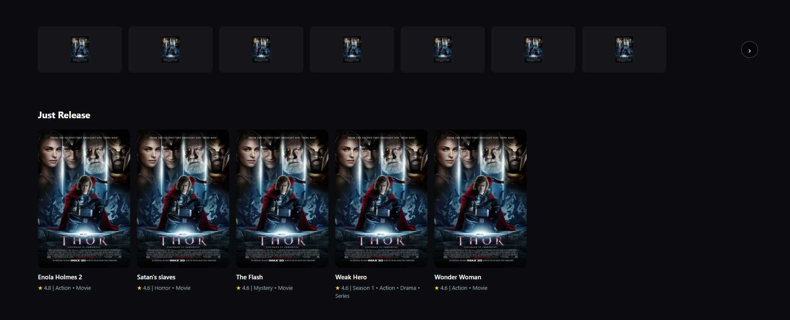


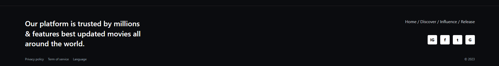

### Detay səhifəsi


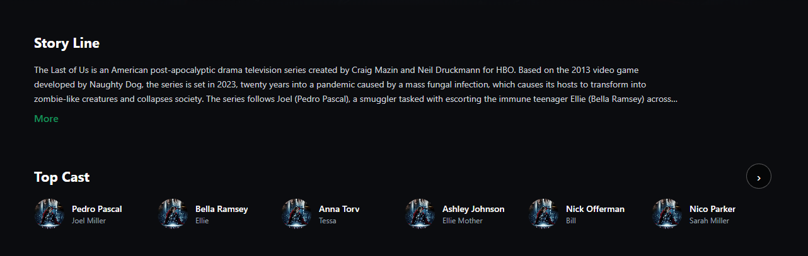

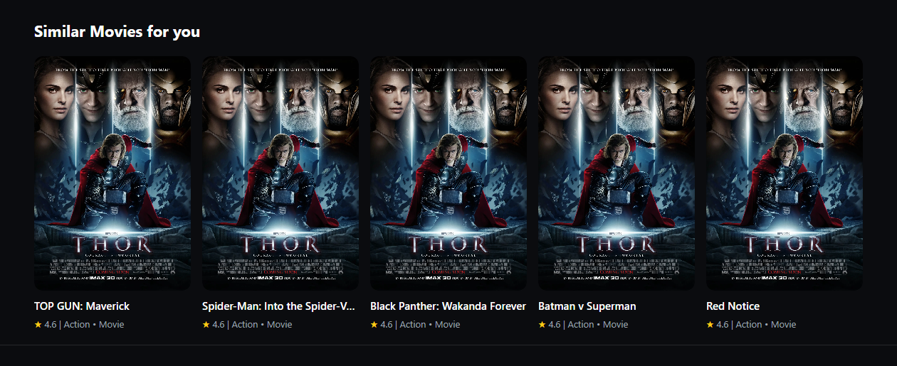
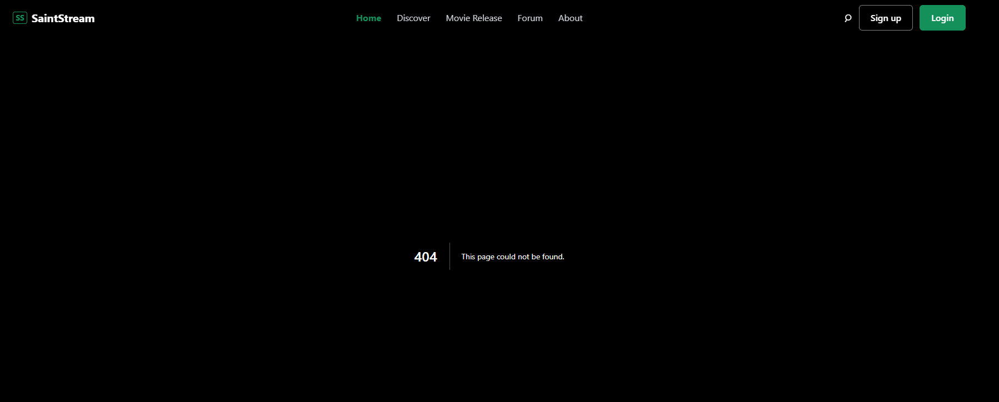

Desktop ilə tablet görünüşü demək olar ki eynidir.

### Mobil görünüş

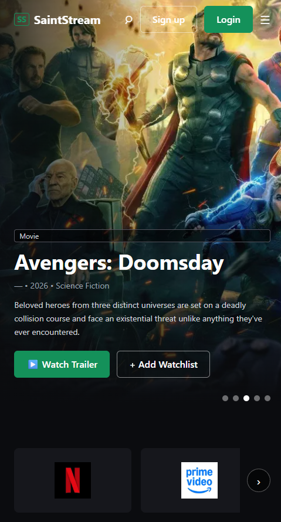
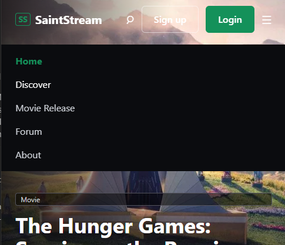
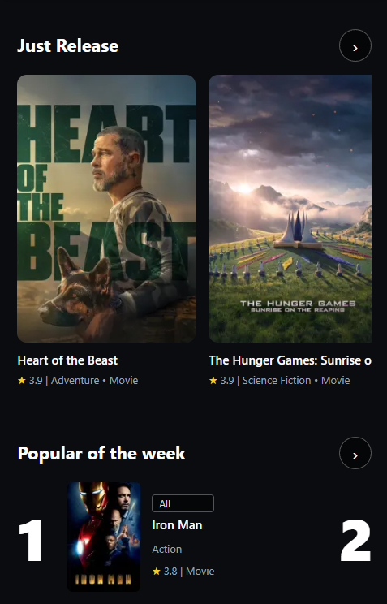
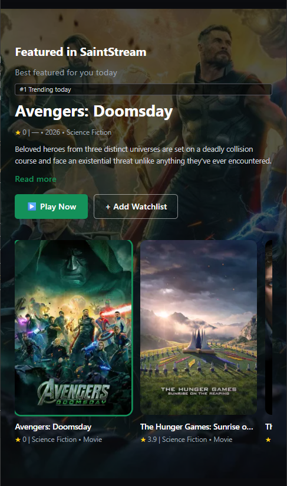
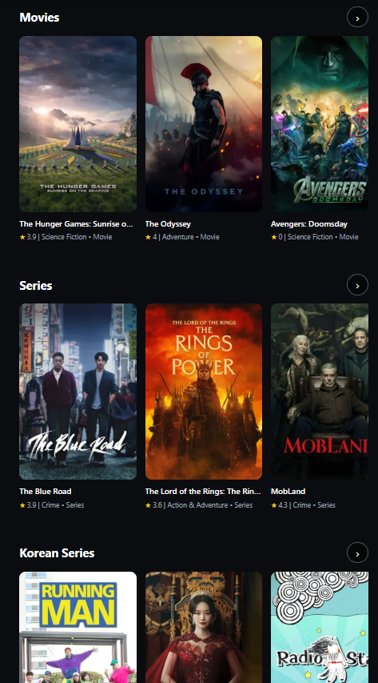
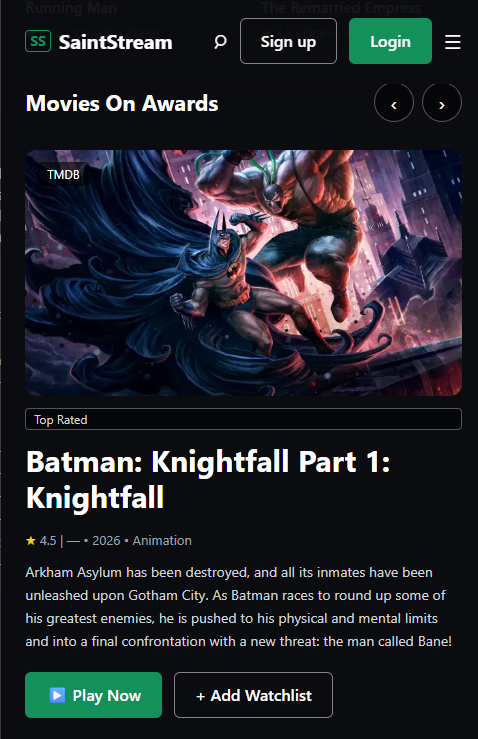
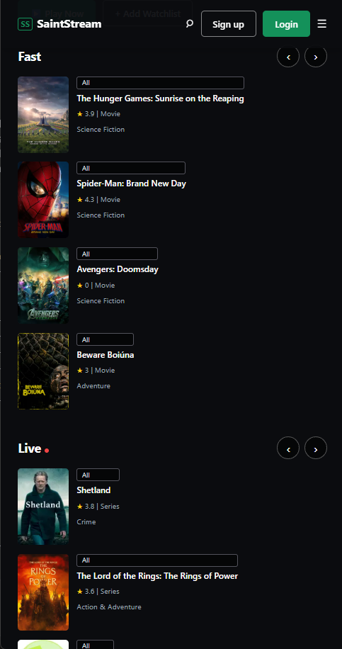
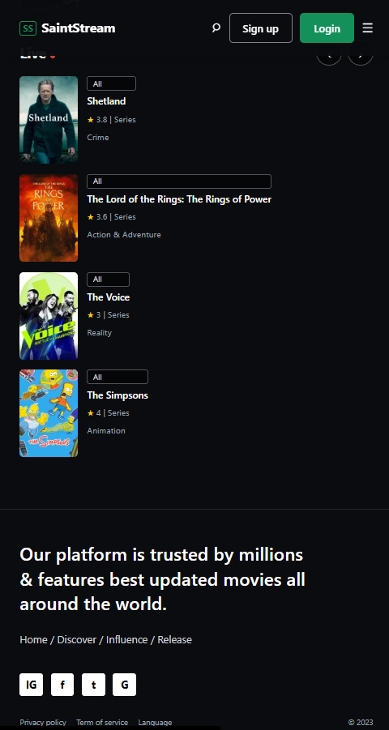
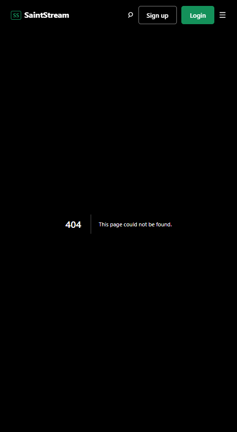
---

## Məlumat mənbəyi

Ana səhifədəki bölmələrin məlumatı **TMDB API v3**-dən gəlir:

| Bölmə | TMDB endpoint |
| --- | --- |
| Hero slider | `/trending/all/week` (ilk 5) |
| Platformalar | `/watch/providers/movie` (US, ilk 7) |
| Just Release | `/movie/now_playing` |
| Popular of the week | `/discover/movie` (populyarlıq, ilk 10) |
| Featured | `/trending/movie/day` (ilk 4) |
| Movies | `/trending/movie/week` |
| Series | `/trending/tv/week` |
| Korean Series | `/discover/tv` (`with_original_language=ko`) |
| Movies On Awards | `/movie/top_rated` (ilk 5) |
| Fast | `/movie/upcoming` (8) |
| Live | `/tv/on_the_air` (8) |

Detay səhifəsi (`/series/tlou`) hələ `data/mockData.js`-dəki məlumatla işləyir.

## Xüsusiyyətlər

### Ana səhifə (`/`)

- **Hero slider:** 5 saniyədən bir avtomatik keçid. Nöqtəyə klik edəndə həmin slayd açılır və sayğac sıfırlanır.
- **Platform sırası:** loqolar üfüqi sürüşdürülür.
- **Universal kart sırası:** Just Release, Movies, Series və Korean Series eyni `MovieSection` komponentindən qurulub.
- **Popular of the week:** 1–10 sıra, reytinq və populyarlıq.
- **Featured:** kart seçildikdə sol məzmun və arxa fon dəyişir. "Read more" mətni açıb-bağlayır.
- **Movies On Awards:** dairəvi keçidli slider.
- **Fast və Live:** eyni komponent, oxlarla 4-4 sürüşdürmə.
- **Add Watchlist:** vizual toggle.

### Detay səhifəsi (`/[type]/[id]`)

- **Hero:** arxa fon, etiket, ad, metadata, "Continue Watching" və "Add Watchlist". Sağda "Download", "Share" və "Like".
- **Story Line:** mətn 3 sətirə qısalır, "More" və "Less" ilə açılıb-bağlanır.
- **Top Cast:** dairəvi aktyor şəkilləri, aktyor və personaj adı, üfüqi sürüşmə.
- **Məzmun tabları:** Episode, Universe, News, Reviews. Aktiv tabın altında yaşıl xətt var. Hazırda yalnız Episode dolu, digərləri "Yaxında" göstərir.
- **Epizodlar:** sezon dropdown-u, seçilmiş sezona görə siyahı və hər kartda `progressPercent`-ə görə progress bar.
- **Similar Movies:** `similarMovieIds`-ə görə ana səhifədəki `MovieCard` ilə göstərilir.
- **404:** yanlış `type` və ya `id` daxil edildikdə `notFound()` çağırılır.

### Ümumi

- **Yüklənmə:** hər bölmənin öz skeleton-u var.
- **Xəta:** bir bölmə xəta versə, digərləri işləyir və həmin yerdə "Məlumat yüklənə bilmədi" yazısı çıxır.
- **Responsive:** desktop, tablet və mobil. Mobildə hamburger menyu.
- **Performans:** ekranın yuxarısındakı şəkillər `priority` ilə yüklənir.
- **Favicon:** `app/icon.svg`.

## Marşrutlar

| Ünvan | Nə göstərir |
| --- | --- |
| `/` | Ana səhifə (TMDB məlumatı ilə) |
| `/series/tlou` | The Last Of Us Season 1 detayı |
| TMDB kartları (`/movie/{id}`, `/series/{id}`) | Hazırda 404. Detay datası yalnız `tlou` üçün var |
| `/series/abc`, `/movie/tlou` | 404 |

## Texnologiyalar

- [Next.js 14.2](https://nextjs.org/) (App Router)
- [React 18.3](https://react.dev/)
- [Tailwind CSS 3.4](https://tailwindcss.com/)
- [TMDB API v3](https://developer.themoviedb.org/reference/intro/getting-started)
- JavaScript (TypeScript istifadə olunmur)

## Qovluq strukturu
```
saintstream-next/
├── .next/                          # Next.js build cache (Git-ə göndərilmir)
├── app/
│   ├── [type]/
│   │   └── [id]/
│   │       └── page.jsx            # Detay səhifəsi (/series/tlou)
│   ├── globals.css                 # Tailwind direktivləri və komponent sinifləri
│   ├── icon.svg                    # Saytın ikonu (favicon)
│   ├── layout.jsx                  # Navbar və Footer (bütün səhifələrdə)
│   └── page.jsx                    # Ana səhifə (/)
├── components/
│   ├── detail/                     # Detay səhifəsi komponentləri
│   │   ├── ContentTabs.jsx         # Episode, Universe, News, Reviews tabları
│   │   ├── DetailHero.jsx          # Detay səhifəsinin hero hissəsi
│   │   ├── EpisodeCard.jsx         # Bir epizod kartı və progress bar
│   │   ├── EpisodeList.jsx         # Seçilmiş sezonun epizodları
│   │   ├── SeasonDropdown.jsx      # Sezon seçimi
│   │   ├── SimilarMovies.jsx       # Oxşar filmlər sırası
│   │   ├── StoryLine.jsx           # Story Line, More / Less
│   │   └── TopCast.jsx             # Aktyorlar sırası
│   ├── home/                       # Ana səhifə bölmələri
│   │   ├── AwardsSlider.jsx        # Movies On Awards (dairəvi slider)
│   │   ├── FastLiveColumn.jsx      # Fast və Live (eyni komponent)
│   │   ├── FeaturedSection.jsx     # Featured in SaintStream
│   │   ├── HeroBanner.jsx          # Hero slider (5 saniyə avtomatik keçid)
│   │   ├── MovieSection.jsx        # Just Release, Movies, Series, Korean Series
│   │   ├── PlatformRow.jsx         # Platforma loqoları
│   │   └── PopularOfWeek.jsx       # Popular of the week (1–10)
│   ├── layout/                     # Ümumi hissələr
│   │   ├── Footer.jsx
│   │   └── Navbar.jsx
│   ├── ui/                         # Təkrar istifadə olunan parçalar
│   │   ├── Img.jsx                 # next/image sarğısı
│   │   ├── MovieCard.jsx           # Film kartı (bütün sıralarda)
│   │   ├── SectionHeader.jsx       # Bölmə başlığı və oxlar
│   │   └── SectionState.jsx        # Yüklənir / xəta / məzmun halı
│   └── HomePage.jsx                # Ana səhifə bölmələrinin yığılması
├── data/
│   └── mockData.js                 # Detay səhifəsinin mock datası
├── docs/
│   └── screenshots/                # README üçün ekran görüntüləri
├── hooks/
│   ├── useRowScroll.js             # Üfüqi sıra sürüşdürmə
│   └── useTMDB.js                  # TMDB datası üçün loading / error hook-u
├── lib/
│   └── tmdb.js                     # Bütün TMDB sorğuları və data formatlaması
├── node_modules/                   # npm paketləri (Git-ə göndərilmir)
├── public/
│   └── images/                     # Şəkillər (test şəkli: Thor_poster_02.webp)
├── utils/
│   ├── format.js                   # 160 dəqiqə → 2h40m
│   └── links.js                    # Karttan detay ünvanı yaradır
├── .env.local                      # TMDB API key (Git-ə göndərilmir)
├── .gitignore
├── next.config.js                  # TMDB şəkilləri üçün icazə
├── package-lock.json
├── package.json
├── postcss.config.js
├── README.md
└── tailwind.config.js
```
## Quraşdırma

**Tələblər:** Node.js 18.17 və ya daha yeni (tövsiyə olunan: 20 LTS) və npm.

### 1. TMDB API key alın

1. [themoviedb.org](https://www.themoviedb.org/) saytında pulsuz hesab yaradın.
2. **Settings → API** bölməsinə keçin.
3. **API Key** (v3 auth) dəyərini kopyalayın. Read Access Token yox.

### 2. Layihəni yükləyin

```bash
git clone https://github.com/togrulhuseynli05/saintstream-movie.git
cd saintstream-movie
npm install
```

### 3. `.env.local` faylı yaradın

Layihənin kökündə (`package.json` ilə eyni qovluqda) `.env.local` adlı fayl yaradın və bunu yazın:

```
NEXT_PUBLIC_TMDB_API_KEY=buraya_api_keyinizi_yazin
```

Bu fayl `.gitignore`-dadır, GitHub-a göndərilmir.

### 4. İşə salın

```bash
npm run dev
```

Key yoxdursa, bölmələrdə "Məlumat yüklənə bilmədi" yazısı görünəcək. Dəyişikliyi əks etdirmək üçün `.env.local` yazdıqdan sonra `npm run dev`-i yenidən başladın.

## Scriptlər

| Komanda | Təsvir |
| `npm run dev` | Development rejimi, dəyişikliklər dərhal görünür |
| `npm run build` | Production build |
| `npm run start` | Build olunmuş versiyanı işə salır (əvvəl `npm run build` lazımdır) |

## Data axını

```
Komponent → useTMDB(fetchHero) → lib/tmdb.js → fetch → TMDB API
                                      ↓
                                 toCard (formatlama)
                                      ↓
                  SectionState → children(data) → Komponent
```

- `lib/tmdb.js` TMDB-nin xam cavabını komponentlərin gözlədiyi formaya çevirir.
- `useTMDB` yüklənmə, xəta və uğurlu halı idarə edir.
- `SectionState` hər bölmənin üç halını göstərir: skeleton, xəta və məzmun.

## Şəkillər

Hazırda bütün test şəkilləri `public/images/Thor_poster_02.webp` faylıdır. TMDB-dən gələn real şəkillər `image.tmdb.org` ünvanından yüklənir və `next.config.js`-də icazə verilib.

Şəkil yoxdursa, `lib/tmdb.js`-dəki `PLACEHOLDER_IMAGE` göstərilir.

## Deploy

### Vercel (əsas)

1. GitHub repo-su Vercel-ə bağlanır (**Add New → Project → Import**).
2. Framework avtomatik **Next.js** seçilir, Root Directory `./`.
3. **Settings → Environment Variables** bölməsinə `NEXT_PUBLIC_TMDB_API_KEY` əlavə edilir (Production, Preview və Development üçün).
4. Production branch: `main`. `main`-ə hər push yeni production deploy yaradır. Digər branch-lərə push olunanda preview linki yaranır.

Environment variable əlavə etdikdən sonra **Redeploy** edin, çünki `NEXT_PUBLIC_` dəyişənləri build zamanı kodun içinə yazılır.

### GitHub Pages (alternativ)

`next.config.js`-də `output: 'export'`, `images.unoptimized` və `basePath` təyin edilməli, `.github/workflows/deploy.yml` faylı əlavə olunmalıdır. Bu rejimdə detay səhifəsi yalnız `generateStaticParams`-dakı ünvanlarla yaranır, TMDB bölmələri isə brauzerdə işləyir.

## Git iş axını

- `main`: production branch, Vercel bu branch-dən deploy edir.
- `feature/home-ui`: ana səhifənin inkişafı.
- `feature/detail-page`: detay səhifəsinin inkişafı.
- `feature/tmdb-api`: TMDB inteqrasiyası.

## Məlum məhdudiyyətlər

- **API key brauzerdə görünür.** `NEXT_PUBLIC_` dəyişənləri belə işləyir. TMDB pulsuz key üçün adi haldır, amma həssas key üçün sorğuları server tərəfdə (Route Handler) etmək lazımdır.
- **TMDB kartlarının detay səhifəsi yoxdur.** Kartlar `/movie/{id}` və ya `/series/{id}` ünvanına keçir, amma detay datası yalnız The Last Of Us üçündür. Digərləri 404 verir.
- **Hero trailer düyməsi** YouTube-da axtarışa yönləndirir, birbaşa trailer linki TMDB-nin `videos` endpoint-i ilə ayrıca alınmalıdır.
- **Yenidən cəhd düyməsi yoxdur.** Xəta olanda səhifəni yeniləmək lazımdır.
- **Platformalar** ABŞ (`US`) üçündür.
- **Movies On Awards** bölməsində TMDB-nin "top rated" siyahısı göstərilir, rəsmi mükafat məlumatı deyil.
- **Yaş reytinqi** TMDB-nin `adult` sahəsindən hesablanır, rəsmi sertifikat deyil.
- **Hero və detay şəkilləri** bəzi filmlərdə olmaya bilər, bu halda placeholder göstərilir.
- Universe, News və Reviews tabları hazırda "Yaxında" göstərir.
- Season 2-nin epizodları yoxdur.
- Awards, Fast və Live bölmələri sadələşdirilib, Figma ilə ölçü fərqləri ola bilər.
- Footer-dəki sosial ikonlar hərflərlə göstərilir.

## Müəllif

GitHub: [@togrulhuseynli05](https://github.com/togrulhuseynli05)