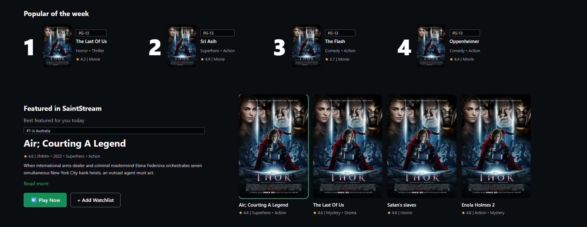
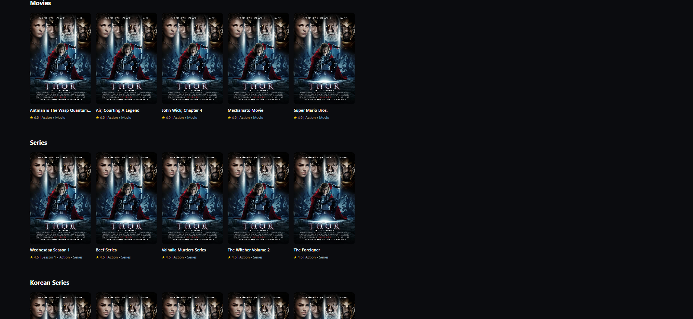
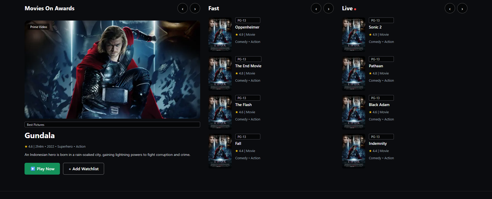
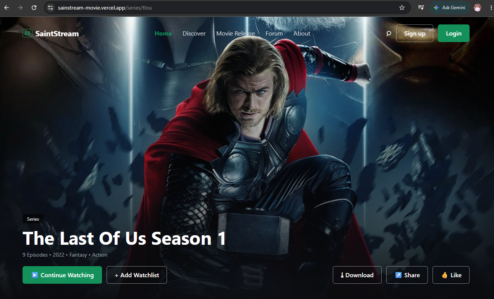
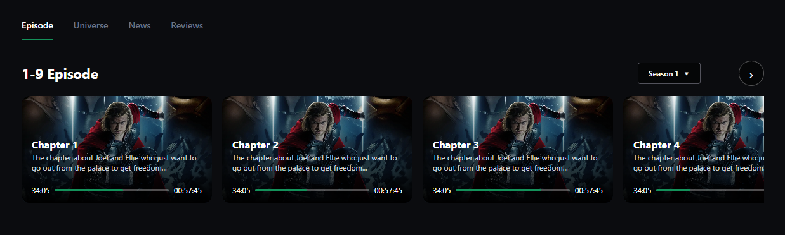

# SaintStream — Film Platforması

Film və serial platforması üçün ana səhifə və detay səhifəsinin **Next.js (App Router)** və **Tailwind CSS** ilə qurulmuş versiyası. Dizayn Figma ekranlarına əsaslanır. Bütün məlumat mock fayldan gəlir, API hələ qoşulmayıb.

**Canlı demo:** [VERCEL_LINKINIZI_BURAYA_YAZIN](https://vercel.com/togrul2/sainstream-movie)

---

## Ekran görüntüləri

### Ana səhifə







### Detay səhifəsi






---

## Xüsusiyyətlər

### Ana səhifə (`/`)

- **Hero slider:** 5 saniyədən bir avtomatik keçid. Nöqtəyə klik edəndə həmin slayd açılır və sayğac sıfırlanır.
- **Platform sırası:** loqolar üfüqi sürüşdürülür.
- **Universal kart sırası:** Just Release, Movies, Series və Korean Series eyni `MovieSection` komponentindən qurulub.
- **Popular of the week:** 1–4 sıra, PG-13 nişanı və ulduz reytinqi.
- **Featured:** kart seçildikdə sol məzmun və arxa fon dəyişir. "Read more" mətni açıb-bağlayır.
- **Movies On Awards:** dairəvi keçidli slider.
- **Fast və Live:** eyni komponent, oxlarla 4-4 sürüşdürmə.
- **Add Watchlist:** vizual toggle.

### Detay səhifəsi (`/[type]/[id]`)

- **Hero:** arxa fon, etiket, ad, metadata, "Continue Watching" və "Add Watchlist". Sağda "Download", "Share" və "Like".
- **Story Line:** mətn 3 sətirə qısalır, "More" və "Less" ilə açılıb-bağlanır.
- **Top Cast:** dairəvi aktyor şəkilləri, aktyor və personaj adı, üfüqi sürüşmə.
- **Məzmun tabları:** Episode, Universe, News, Reviews. Aktiv tabın altında yaşıl xətt var. Hazırda yalnız Episode dolu, digərləri "Yaxında" göstərir.
- **Epizodlar:** sezon dropdown-u, seçilmiş sezona görə siyahı və hər kartda `progressPercent`-ə görə progress bar.
- **Similar Movies:** `similarMovieIds`-ə görə ana səhifədəki `MovieCard` komponenti ilə göstərilir.
- **404:** yanlış `type` və ya `id` daxil edildikdə `notFound()` çağırılır.

### Ümumi

- **Responsive:** desktop, tablet və mobil. Mobildə hamburger menyu.
- **Layout:** Navbar və Footer `app/layout.jsx`-dən gəlir və bütün səhifələrdə eynidir.
- **Keçid:** ana səhifədəki kartlar `utils/links.js` vasitəsilə detay səhifəsinə bağlanır.

## Marşrutlar

| Ünvan | Nə göstərir |
| --- | --- |
| `/` | Ana səhifə |
| `/series/tlou` | The Last Of Us Season 1 detayı |
| `/series/abc`, `/movie/tlou` | 404 (id və ya type tapılmır) |

Hazırda yalnız `tlou` üçün detal datası var. Digər kartlar detay səhifəsinə keçir, amma 404 göstərir. Bu, `movieDetails`-ə yeni qeyd əlavə edilənə qədər belədir.

## Texnologiyalar

- [Next.js 14](https://nextjs.org/) (App Router)
- [React 18](https://react.dev/)
- [Tailwind CSS 3](https://tailwindcss.com/)
- JavaScript (TypeScript istifadə olunmur)

## Qovluq strukturu

```
saintstream-next/
├── app/
│   ├── [type]/
│   │   └── [id]/
│   │       └── page.jsx        # Detay səhifəsi (/series/tlou, /movie/...)
│   ├── icon.svg                # Saytın ikonu (favicon)
│   ├── layout.jsx              # Navbar və Footer (bütün səhifələrdə)
│   ├── page.jsx                # Ana səhifə (/)
│   └── globals.css             # Tailwind direktivləri və komponent sinifləri
├── components/
│   ├── detail/                 # Detay səhifəsi komponentləri
│   │   ├── DetailHero.jsx
│   │   ├── StoryLine.jsx
│   │   ├── TopCast.jsx
│   │   ├── ContentTabs.jsx
│   │   ├── EpisodeList.jsx
│   │   ├── EpisodeCard.jsx
│   │   ├── SeasonDropdown.jsx
│   │   └── SimilarMovies.jsx
│   ├── home/                   # Ana səhifə bölmələri
│   ├── layout/                 # Navbar, Footer
│   ├── ui/                     # Təkrar istifadə olunan parçalar (MovieCard, Img, SectionHeader)
│   └── HomePage.jsx            # Ana səhifə bölmələrinin yığılması
├── data/
│   └── mockData.js             # Bütün mock data (ana səhifə və detay)
├── hooks/
│   └── useRowScroll.js         # Üfüqi sıra sürüşdürmə hook-u
├── utils/
│   ├── format.js               # 160 dəqiqə → 2h40m
│   └── links.js                # Karttan detay ünvanı yaradır
├── public/
│   └── images/                 # Şəkillər
└── docs/
    └── screenshots/            # README üçün ekran görüntüləri
```

## Quraşdırma

**Tələblər:** Node.js 18.17 və ya daha yeni (tövsiyə olunan: 20 LTS) və npm.

```bash
git clone https://github.com/togrulhuseynli05/saintstream-movie.git
cd saintstream-movie
npm install
npm run dev
```

## Scriptlər

| Komanda | Təsvir |
| --- | --- |
| `npm run dev` | Development rejimi, dəyişikliklər dərhal görünür |
| `npm run build` | Production build |
| `npm run start` | Build olunmuş versiyanı işə salır (əvvəl `npm run build` lazımdır) |

## Şəkillər

Şəkillər `public/images/` qovluğunda saxlanılır. Hazırda bütün kartlar test şəkli ilə göstərilir:

```js
const PLACEHOLDER_IMG = '/images/Thor_poster_02.webp';
```

Real şəkil əlavə edəndə həmin yolu dəyişin, məsələn `'/images/posters/air.jpg'`. Fayl adı böyük-kiçik hərfə həssasdır.

Ekran görüntüləri `docs/screenshots/` qovluğundadır və yalnız README üçündür. Tətbiq onlardan istifadə etmir.

## Data

Komponentlər datanı **props** ilə alır. `data/mockData.js` yalnız səhifə səviyyəsində (`app/page.jsx` və `app/[type]/[id]/page.jsx`) import olunur.

- Ana səhifə: `heroMovies`, `platforms`, `justRelease`, `movies`, `series`, `koreanSeries`, `popularWeekMovies`, `featuredMovies`, `awardsMovies`, `fastMovies`, `liveMovies`.
- Detay səhifəsi: `movieDetails`, `similarMovies` və `getMovieDetail(type, id)` funksiyası.

Yeni detay səhifəsi əlavə etmək üçün:

1. `movieDetails`-ə yeni obyekt əlavə edin (`id`, `type`, `cast`, `seasons`, `episodes`, `similarMovieIds` və s.).
2. `similarMovieIds`-də istifadə olunan filmləri `similarMovies`-ə əlavə edin.
3. Ana səhifədəki kartın `type` və `id` dəyərləri detay qeydi ilə eyni olmalıdır, ki, keçid düzgün açılsın.

## Performans

- Hero və detay hero şəkilləri `priority` ilə yüklənir (LCP üçün).
- `generateStaticParams` detay səhifələrini build zamanı hazırlayır.
- Favicon `app/icon.svg` faylından götürülür.

## Deploy

### Vercel (əsas)

1. GitHub repo-su Vercel-ə bağlanır (**Add New → Project → Import**).
2. Framework avtomatik **Next.js** seçilir, Root Directory `./`.
3. Production branch: `main`. `main`-ə hər push yeni production deploy yaradır. Digər branch-lərə push olunanda preview linki yaranır.

### GitHub Pages (alternativ)

`next.config.js`-də `output: 'export'`, `images.unoptimized` və `basePath` təyin edilməli, `.github/workflows/deploy.yml` faylı əlavə olunmalıdır. Repo-da **Settings → Pages → Source** hissəsində **GitHub Actions** seçilir. Bu rejimdə detay səhifəsi yalnız `generateStaticParams`-dakı ünvanlarla yaranır.

## Git iş axını

- `main`: production branch, Vercel bu branch-dən deploy edir.
- `feature/home-ui`: ana səhifənin inkişafı.
- `feature/detail-page`: detay səhifəsinin inkişafı.

## Məlum məhdudiyyətlər

- Hero slaydlarının 2–5-ci təsvirləri placeholder-dir.
- Bütün şəkillər hazırda eyni test şəklidir.
- Detay datası yalnız The Last Of Us üçündür.
- Universe, News və Reviews tabları hazırda "Yaxında" göstərir.
- Season 2-nin epizodları yoxdur.
- Story Line-dakı altı xətli linklər hələ sadə mətndir.
- Awards, Fast və Live bölmələri sadələşdirilib, Figma ilə ölçü fərqləri ola bilər.
- Footer-dəki sosial ikonlar hərflərlə göstərilir.
- API qoşulmayıb.

## Müəllif

GitHub: [@togrulhuseynli05](https://github.com/togrulhuseynli05)