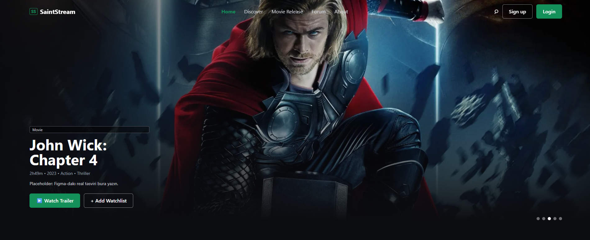

# SaintStream — Film Platforması (Ana Səhifə)

Film platforması ana səhifəsinin **Next.js (App Router)** və **Tailwind CSS** ilə qurulmuş versiyası. Dizayn Figma ekranlarına əsaslanır. Hazırda bütün məlumat `mock` fayldan gəlir, API hələ qoşulmayıb.

**Canlı demo:** ([https://sainstream-movie.vercel.app](https://vercel.com/togrul2/sainstream-movie))

---

## Ekran görüntüləri




## Xüsusiyyətlər

- **Hero slider:** 5 saniyədən bir avtomatik keçid. Nöqtəyə klik edəndə həmin slayda keçir və sayğac sıfırlanır.
- **Platform sırası:** loqolar üfüqi sürüşdürülür.
- **Universal kart sırası:** Just Release, Movies, Series və Korean Series eyni `MovieSection` komponentindən qurulub.
- **Popular of the week:** 1–4 sıra, PG-13 nişanı və ulduz reytinqi.
- **Featured:** kart seçəndə sol məzmun və arxa fon dəyişir, "Read more" mətni açılıb-bağlanır.
- **Movies On Awards:** dairəvi keçidli slider.
- **Fast və Live:** eyni komponent, oxlarla 4-4 sürüşdürmə.
- **Add Watchlist:** vizual toggle.
- **Responsive:** desktop, tablet və mobil. Mobildə hamburger menyu.

## Texnologiyalar

- [Next.js 14](https://nextjs.org/) (App Router)
- [React 18](https://react.dev/)
- [Tailwind CSS 3](https://tailwindcss.com/)
- JavaScript (TypeScript istifadə olunmur)

## Qovluq strukturu

```
saintstream-movie/
├── app/
│   ├── layout.jsx          # Navbar və Footer (bütün səhifələrdə)
│   ├── page.jsx            # Ana səhifə (/)
│   └── globals.css         # Tailwind və komponent sinifləri
├── components/
│   ├── layout/             # Navbar, Footer
│   ├── home/               # Ana səhifə bölmələri
│   ├── ui/                 # Təkrar istifadə olunan parçalar
│   └── HomePage.jsx        # Bölmələrin yığılması
├── data/
│   └── mockData.js         # Bütün mock data
├── hooks/
│   └── useRowScroll.js     # Üfüqi sıra sürüşdürmə hook-u
├── utils/
│   └── format.js           # Dəqiqəni 2h40m formatına çevirir
├── public/
│   └── images/             # Şəkillər
└── docs/
    └── screenshots/        # README üçün ekran görüntüləri
```

## Quraşdırma

**Tələblər:** Node.js 18.17 və ya daha yeni (tövsiyə olunan: 20 LTS) və npm.

```bash
git clone https://github.com/togrulhuseynli05/saintstream-movie.git
cd saintstream-movie
npm install
npm run dev
```


## Scriptlər

| Komanda | Təsvir |
| --- | --- |
| `npm run dev` | Development rejimi, dəyişikliklər dərhal görünür |
| `npm run build` | Production build |
| `npm run start` | Build olunmuş versiyanı işə salır (əvvəl `npm run build` lazımdır) |

## Şəkillər

Şəkillər `public/images/` qovluğunda saxlanılır. `data/mockData.js`-dəki yollar bu qovluğa aiddir.

Hazırda bütün kartlar test şəkli ilə göstərilir:

```js
const PLACEHOLDER_IMG = '/images/Thor_poster_02.webp';
```

Real şəkil əlavə edəndə həmin sətirdə `PLACEHOLDER_IMG`-i real yolla əvəz edin, məsələn `'/images/posters/air.jpg'`.

## Data haqqında

Komponentlər datanı **props** ilə alır. `mockData` yalnız `app/page.jsx`-də import olunur. Buna görə API-yə keçəndə dəyişiklik bir yerdə edilir.

## Deploy

### Vercel (əsas)

1. GitHub repo-su Vercel-ə bağlanır (**Add New → Project → Import**).
2. Framework avtomatik **Next.js** seçilir.
3. Production branch: `main`.
4. `main`-ə hər push yeni production deploy yaradır. Digər branch-lərə push olunanda preview link yaranır.

### GitHub Pages (alternativ)

GitHub Pages üçün `next.config.js`-də `output: 'export'` və `basePath` təyin edilməli, `.github/workflows/deploy.yml` faylı əlavə olunmalıdır. Repo-da **Settings → Pages → Source** hissəsində **GitHub Actions** seçilməlidir.

## Git iş axını

- `main`: production branch, Vercel bu branch-dən deploy edir.
- `feature/home-ui`: inkişaf branch-i.

## Məlum məhdudiyyətlər

- Hero slaydlarının 2–5-ci təsvirləri placeholder-dir.
- Bütün şəkillər hazırda eyni test şəklidir.
- Awards, Fast və Live bölmələri sadələşdirilib, Figma ilə ölçü fərqləri ola bilər.
- Footer-dəki sosial ikonlar hələlik hərflərlə göstərilir.

## Müəllif

GitHub: [@togrulhuseynli05](https://github.com/togrulhuseynli05)
